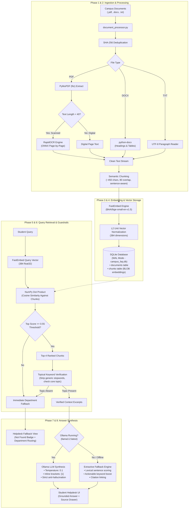

# 🎓 Campus FAQ Retrieval-Augmented Generation (RAG) System

[](https://www.python.org/)
[](https://fastapi.tiangolo.com/)
[](https://github.com/qdrant/fastembed)
[](https://ollama.com/)
[](https://www.sqlite.org/)
[]()
[](#)

A high-performance, privacy-first, 100% local **Campus FAQ Helpdesk Assistant** built with **FastAPI**, **FastEmbed**, **SQLite**, and **Ollama (Llama 3.2)**. 

Designed specifically for educational institutions, this system ingests campus policies, handbooks, and FAQs across **PDF**, **DOCX**, and **TXT** formats, performs high-precision semantic search, and synthesizes accurate, conversational answers with **inline verifiable citations (`[1]`, `[2]`)** and **strict anti-hallucination guardrails**.

---

## 📑 Table of Contents

- [🏛️ About The Project](#️-about-the-project)
  - [The Problem with Campus Information](#the-problem-with-campus-information)
  - [The RAG Solution](#the-rag-solution)
  - [Key Highlights](#key-highlights)
- [🧠 The Core Concept: What is RAG?](#-the-core-concept-what-is-rag)
  - [Why Not Just Use ChatGPT or Fine-Tuning?](#why-not-just-use-chatgpt-or-fine-tuning)
- [🔬 The End-to-End RAG Pipeline Architecture](#-the-end-to-end-rag-pipeline-architecture)
  - [System Architecture Diagram](#system-architecture-diagram)
  - [Phase 1: Multi-Format Document Ingestion & Dual-Mode OCR](#phase-1-multi-format-document-ingestion--dual-mode-ocr)
  - [Phase 2: Semantic Chunking & Metadata Preservation](#phase-2-semantic-chunking--metadata-preservation)
  - [Phase 3: Dense Vector Embeddings (FastEmbed & ONNX)](#phase-3-dense-vector-embeddings-fastembed--onnx)
  - [Phase 4: SQLite Vector Storage (WAL Mode & Binary BLOBs)](#phase-4-sqlite-vector-storage-wal-mode--binary-blobs)
  - [Phase 5: Vector Retrieval & Cosine Similarity Ranking](#phase-5-vector-retrieval--cosine-similarity-ranking)
  - [Phase 6: Topical Keyword Verification Guardrail](#phase-6-topical-keyword-verification-guardrail)
  - [Phase 7: Dual-Mode Answer Generation (Ollama + Extractive Fallback)](#phase-7-dual-mode-answer-generation-ollama--extractive-fallback)
  - [Phase 8: Department Fallback & Out-of-Domain Routing](#phase-8-department-fallback--out-of-domain-routing)
- [🦙 Ollama Integration (Llama 3.2)](#-ollama-integration-llama-32)
  - [Why Ollama & Llama 3.2?](#why-ollama--llama-32)
  - [Dual-Mode Architecture (Works With or Without Ollama)](#dual-mode-architecture-works-with-or-without-ollama)
  - [Ollama Setup & Configuration](#ollama-setup--configuration)
- [💻 User Interface & User Experience](#-user-interface--user-experience)
  - [Student Helpdesk (`/`)](#student-helpdesk-)
  - [Admin Document Portal (`/admin`)](#admin-document-portal-admin)
- [📂 Project Structure](#-project-structure)
- [🛠️ Tech Stack Breakdown](#️-tech-stack-breakdown)
- [🚀 Quickstart & Installation](#-quickstart--installation)
  - [1. Prerequisites](#1-prerequisites)
  - [2. Clone & Setup Virtual Environment](#2-clone--setup-virtual-environment)
  - [3. Install Dependencies](#3-install-dependencies)
  - [4. Generate Sample Documents (Optional)](#4-generate-sample-documents-optional)
  - [5. Run Ollama (Optional for LLM Synthesis)](#5-run-ollama-optional-for-llm-synthesis)
  - [6. Start the Server](#6-start-the-server)
- [🔌 REST API Documentation](#-rest-api-documentation)
- [🧪 Testing & Benchmarks](#-testing--benchmarks)
  - [Running the Pytest Suite](#running-the-pytest-suite)
  - [Running the Retrieval Evaluation Benchmark](#running-the-retrieval-evaluation-benchmark)
  - [Evaluation Results](#evaluation-results)
- [🛡️ Privacy, Security & Grounding Guarantees](#️-privacy-security--grounding-guarantees)
- [🔮 Future Enhancements](#-future-enhancements)

---

## 🏛️ About The Project

### The Problem with Campus Information
In any university or college, critical operational policies are fragmented across dozens of sources:
- Registrar deadlines (add/drop dates, course withdrawal schedules) in PDF bulletins.
- Financial aid, scholarship rules, and FAFSA requirements in scanned brochures.
- Housing quiet hours, room freeze policies, and dining plans in DOCX drafts.
- Health clinic walk-in hours and parking citation appeals on disparate web pages.

When students have questions, they often face:
1. **Keyword Search Frustration**: Searching a campus portal returns links to multiple 40-page PDF files without identifying the specific rule or paragraph.
2. **Conflicting Student Rumors**: Students turn to group chats or peer forums where outdated or inaccurate policies circulate.
3. **Office Bottlenecks**: Helpdesk and registrar staff spend hundreds of hours answering repetitive questions that are already answered in official documents.

### The RAG Solution
This **Campus FAQ RAG System** replaces manual document searching with an intelligent, conversational agent that:
- **Understands natural student language**: Understands concepts like *"Can I get my tuition back if I drop next week?"* without requiring exact keyword matches.
- **Provides instant, direct answers**: Synthesizes the exact policy clause in 1–2 concise paragraphs.
- **Proves its claims**: Every fact is linked to an exact inline citation tag (e.g. `[1]`), backed by an expandable source card showing the original document, page number, section heading, and similarity match percentage.
- **Guarantees anti-hallucination**: If an answer is not present in the indexed documents (e.g., asking about placements when only admissions policies are loaded), the system **refuses to invent facts** and intelligently routes the student to the official campus department (email, phone, and office location).
- **100% Privacy & Zero Ongoing Cost**: Everything runs locally on consumer hardware. No student questions or campus documents leave your server, and no cloud subscriptions (OpenAI, Anthropic, Google Gemini) are required.

---

## 🧠 The Core Concept: What is RAG?

**RAG** stands for **Retrieval-Augmented Generation**. It is an AI architecture that combines the strengths of **information retrieval** (search engines) and **natural language generation** (large language models).

```
   ┌────────────────────────────────────────────────────────┐
   │                       R A G                            │
   │                                                        │
   │   [ RETRIEVE ]                   [ GENERATE ]          │
   │   Search institutional   ───►    Feed retrieved facts  │
   │   database for exact             into local LLM to     │
   │   policy passages                produce a cited answer│
   └────────────────────────────────────────────────────────┘
```

Traditional search engines only **retrieve** (giving you raw documents to read yourself). Standalone LLMs only **generate** (drawing from static pre-training data, frequently fabricating policies or hallucinating numbers). 

RAG merges both:
1. **Retrieve**: When a student asks a question, the system converts the query into a semantic vector and retrieves the top most relevant chunks from the verified campus document database.
2. **Augment**: The system constructs a constrained prompt containing the student's question and the exact retrieved excerpts as authoritative context.
3. **Generate**: A local language model (Llama 3.2 via Ollama) reads the context excerpts and synthesizes a direct, friendly answer, strictly citing facts using inline bracket tags like `[1]`.

### Why Not Just Use ChatGPT or Fine-Tuning?

| Approach | Accurate Dates & Fees? | Real-Time Updates? | Verifiable Citations? | Data Privacy | Ongoing Cost |
| :--- | :---: | :---: | :---: | :---: | :---: |
| **Vanilla Cloud LLM** (ChatGPT) | ❌ High Hallucination Risk | ❌ Static Knowledge Cutoff | ❌ None | ❌ Queries sent to cloud | 💳 Monthly Subscriptions / API tokens |
| **Model Fine-Tuning** | ⚠️ Can still hallucinate | ❌ Requires hours of retraining | ❌ Cannot cite source pages | ⚠️ High compute needed | 💸 Expensive GPU training |
| **This RAG System** | ✅ 100% Grounded in Documents | ✅ Instant (upload PDF in 2 sec) | ✅ Exact page & section citations | ✅ 100% On-Premise / Local | 🆓 **Zero Cost Forever** |

---

## 🔬 The End-to-End RAG Pipeline Architecture

Below is the complete engineering architecture of the system from document upload to answer delivery:

### System Architecture Diagram



---

### Phase 1: Multi-Format Document Ingestion & Dual-Mode OCR
Located in [`app/document_processor.py`](file:///c:/Users/nikhi/Desktop/Rag/app/document_processor.py).
- **Supported Formats**: `.pdf`, `.docx`, `.txt`.
- **Cryptographic Deduplication**: Computes a SHA-256 fingerprint for every uploaded file. If the file is already indexed, the system immediately rejects the duplicate with an informative HTTP 409 error.
- **Dual-Mode PDF Processing**:
  1. *Fast Native Mode*: Reads digital text layers using PyMuPDF (`fitz`) and `pypdf`, preserving original page numbers.
  2. *Automatic OCR Fallback*: When users upload scanned documents, flattened print-to-PDF canvas exports, or image-only guides where digital text character count is `< 40`, the system automatically activates `RapidOCR` (powered by ONNX Runtime). It converts PDF pages into high-resolution pixmaps in-memory and extracts all printed text with zero manual intervention.
- **Structured DOCX & TXT Parsing**: Detects document heading styles (`Heading 1`, `Heading 2`) and tables, annotating every extracted block with its section title.

### Phase 2: Semantic Chunking & Metadata Preservation
Text cannot simply be dumped into an embedding model because long documents exceed token limits and dilute semantic precision.
- **Target Chunk Size**: `~450` characters.
- **Overlap**: `80` characters across boundaries so sentences that bridge two chunks are never cut in half.
- **Sentence-Aware Boundary Splitter**: Splits exclusively along punctuation boundaries (`.`, `!`, `?`, `\n\n`), preventing awkward half-sentence fragments.
- **Rich Metadata Attachment**: Every chunk stores:
  - `document_id`: Parent document foreign key.
  - `page_number`: Exact page number (for PDFs).
  - `section_heading`: Section or topic title.
  - `chunk_index`: Sequence position in the document.

### Phase 3: Dense Vector Embeddings (FastEmbed & ONNX)
Located in [`app/embeddings.py`](file:///c:/Users/nikhi/Desktop/Rag/app/embeddings.py).
- **Embedding Model**: `BAAI/bge-small-en-v1.5` (via `fastembed`).
- **Dimensions**: 384 dimensions.
- **Why FastEmbed?** Unlike heavy PyTorch-based frameworks that require gigabytes of CUDA dependencies and slow startup times, FastEmbed runs on **ONNX Runtime**. It generates embeddings at **sub-millisecond speeds on standard laptop CPUs**.
- **L2 Unit Normalization**: Every generated vector $\mathbf{v}$ is normalized to unit length ($\|\mathbf{v}\|_2 = 1$). This means cosine similarity simplifies to a simple dot product:
  $$\text{Cosine Similarity}(\mathbf{u}, \mathbf{v}) = \sum_{i=1}^{384} u_i \cdot v_i = \mathbf{u} \cdot \mathbf{v}$$

### Phase 4: SQLite Vector Storage (WAL Mode & Binary BLOBs)
Located in [`app/database.py`](file:///c:/Users/nikhi/Desktop/Rag/app/database.py).
Instead of adding complex, memory-heavy external vector databases (like Pinecone, Milvus, or Qdrant) that complicate deployment, the system stores vectors directly inside **SQLite**:
- **Binary Serialization**: 384-dimensional `float32` arrays are stored as compact 1,536-byte raw binary BLOBs (`buffer()` / `tobytes()`).
- **High Concurrency with WAL**: SQLite is configured in **Write-Ahead Logging (WAL)** mode (`PRAGMA journal_mode=WAL`), allowing simultaneous chat queries while administrators upload or delete documents.
- **Relational Integrity**: Foreign keys with `ON DELETE CASCADE` ensure that deleting a document instantly cleans up all associated chunk rows and vector BLOBs.

### Phase 5: Vector Retrieval & Cosine Similarity Ranking
Located in [`app/retriever.py`](file:///c:/Users/nikhi/Desktop/Rag/app/retriever.py).
1. When a student enters a query, FastEmbed vectorizes it into a 384-dimensional float array.
2. The system loads chunk vector BLOBs and computes vectorized matrix dot-products using **NumPy**:
   ```python
   # High-speed vectorized cosine similarity
   scores = np.dot(chunk_matrix, query_vector)
   ```
3. Chunks are filtered against `SIMILARITY_THRESHOLD = 0.55`.
4. The top $K=4$ candidates are returned, ranked from highest to lowest similarity score.

### Phase 6: Topical Keyword Verification Guardrail
Located in [`app/answer_generator.py`](file:///c:/Users/nikhi/Desktop/Rag/app/answer_generator.py).
Dense embeddings can occasionally produce a **false-positive similarity match** when an institutional name is shared across documents.
- *Example*: A student asks `"How was the placements in GITAM??"`. If the database only contains an admissions and exam FAQ, dense vectors might match because the word *"GITAM"* appears frequently throughout the chunks, producing an artificially high score of `0.75`.
- *The Guardrail*: The system strips generic university stopwords (`gitam`, `university`, `campus`, `how`, `was`, `what`, etc.) and isolates the core subject: **`"placements"`**.
- It verifies whether the core topic exists lexically in the retrieved context. If absent, the system **rejects the retrieval**, preventing irrelevant answers and triggering the department fallback.

### Phase 7: Dual-Mode Answer Generation (Ollama + Extractive Fallback)
The system features an automatic dual-mode generator:

#### Mode A: Local LLM Synthesis with Ollama (`llama3.2`)
When Ollama is running locally, it calls `llama3.2:latest` via HTTP API:
- Passes only clean context excerpts tagged with bracket numbers `[1]`, `[2]`.
- Enforces strict grounding rules: do not extrapolate, do not invent dates/fees, cite facts inline with brackets, and do not repeat raw file paths.
- Configured with `temperature: 0.1`, `num_predict: 140`, and `num_ctx: 2048` for ultra-snappy CPU inference (< 10 seconds).

#### Mode B: Verified Extractive Fallback Engine
If Ollama is offline or uninstalled, the system automatically falls back to an internal extractive ranker:
- Breaks retrieved chunks into clean sentences.
- Filters out section headers, question bullets, and metadata lines.
- Scores sentences using query keyword overlap and boosts actionable keywords (`must`, `deadline`, `fee`, `submit`, `contact`, `$`, numbers).
- Formats a structured answer with bullet points and inline citation links `[1]`.

### Phase 8: Department Fallback & Out-of-Domain Routing
If a student's question fails the similarity threshold or is not covered in the documents, the system refuses to guess. Instead, it inspects query keywords and routes the student to the official campus department directory:
- **Placements & Careers** ➔ Career Development & Placement Cell (`placements@gitam.edu`)
- **Tuition & Scholarships** ➔ Financial Aid & Scholarships Office (`finaid@sampleuniv.edu`)
- **Add/Drop & Transcripts** ➔ Office of the Registrar (`registrar@sampleuniv.edu`)
- **Dorms & Meal Plans** ➔ Residence Life & Housing (`housing@sampleuniv.edu`)
- **Clinic & Counseling** ➔ Student Health & Wellness Center (`healthcenter@sampleuniv.edu`)
- **Parking & Shuttles** ➔ Parking & Transportation Services (`parking@sampleuniv.edu`)

---

## 🦙 Ollama Integration (Llama 3.2)

### Why Ollama & Llama 3.2?
- **Ollama** is the modern standard for running open-source language models locally on macOS, Linux, and Windows.
- **Llama 3.2 (3B)** is Meta's state-of-the-art lightweight model. At only 3 billion parameters, it runs with exceptional speed on regular laptop CPUs, fits into less than 3 GB of RAM, and possesses remarkable instruction-following capabilities for grounded question answering.

### Dual-Mode Architecture (Works With or Without Ollama)
This project is built so that **Ollama is 100% optional**:
- If Ollama is running: Responses are synthesized conversationally with `Grounded • Llama 3.2` badge.
- If Ollama is stopped or not installed: The system seamlessly switches to extractive mode with `Grounded Answer` badge without crashing or failing requests.

### Ollama Setup & Configuration
1. **Download Ollama**: Visit [ollama.com](https://ollama.com/download) and install for your OS.
2. **Pull the Llama 3.2 model**:
   ```bash
   ollama pull llama3.2
   ```
3. **Verify Ollama is running**:
   ```bash
   ollama list
   ```
4. **Environment Variables (Optional)**:
   You can customize connection settings in `app/config.py` or via shell environment variables:
   ```bash
   OLLAMA_BASE_URL="http://127.0.0.1:11434"
   OLLAMA_MODEL="llama3.2:latest"
   ```

---

## 💻 User Interface & User Experience

### Student Helpdesk (`/`)
- **Thick, Prominent Input Box**: Accessible, high-contrast text area (`border: 2.5px solid #64748b`, `min-height: 58px`) with dynamic auto-resize.
- **Quick-Prompt Chips**: Clickable sample questions to explore campus policies immediately.
- **Inline Citations**: Every claim features a clickable citation badge `[1]` that links directly to its source.
- **Expandable Source Drawer**: Click "View Supporting Sources" to open detailed source cards displaying the document name, page number, similarity match %, and raw text excerpt.
- **Real-Time Badges**:
  - `Grounded • Llama 3.2`: Generated by local LLM.
  - `Grounded Answer`: Generated by verified extractive engine.
  - `Not Found in Documents`: Out-of-domain or unanswerable query with department routing.

### Admin Document Portal (`/admin`)
- **Drag-and-Drop Ingestion**: Upload `.pdf`, `.docx`, and `.txt` files directly in your browser.
- **Duplicate Prevention**: Rejects duplicate documents automatically via SHA-256 fingerprinting.
- **One-Click Sample Loader**: Indexes 5 pre-packaged sample campus policy documents covering Registrar, Housing, Health, Parking, and Financial Aid.
- **Chunk Inspector Modal**: Click "View Chunks" on any document to inspect exactly how the text was partitioned, including token lengths, headings, and page assignments.
- **Cascade Deletion**: Safely delete any document to remove all its chunks and vector BLOBs from SQLite in a single transaction.

---

## 📂 Project Structure

```
c:\Users\nikhi\Desktop\Rag\
├── app/
│   ├── __init__.py
│   ├── config.py                 # Paths, models, chunk sizes, thresholds, campus directory
│   ├── database.py               # SQLite schema, WAL mode, vector BLOB storage, migrations
│   ├── document_processor.py     # Multi-format parser (fitz, pypdf, RapidOCR, docx, txt)
│   ├── embeddings.py             # FastEmbed singleton (BAAI/bge-small-en-v1.5, ONNX)
│   ├── retriever.py              # Vector cosine similarity search, top-k ranking, threshold
│   ├── answer_generator.py       # Ollama Llama 3.2 synthesizer, extractive mode, keyword guard
│   ├── main.py                   # FastAPI REST API endpoints & Jinja2 template routes
│   ├── static/
│   │   ├── css/
│   │   │   └── style.css         # High-contrast, clean campus helpdesk design
│   │   └── js/
│   │       ├── chat.js           # Student chat logic, auto-resize, citation links, badge rendering
│   │       └── admin.js          # File upload, deletion, chunk inspection modal
│   └── templates/
│       ├── base.html             # Shared HTML layout & navigation bar
│       ├── chat.html             # Student Helpdesk interface
│       └── admin.html            # Admin Document Management portal
├── sample_docs/                  # Pre-packaged campus policy documents
│   ├── academic_calendar_and_registration.txt
│   ├── campus_parking_and_transportation.txt
│   ├── housing_and_dining_policies.docx
│   ├── student_financial_services.pdf
│   └── student_health_and_wellness.txt
├── tests/
│   ├── test_answers.py           # Unit tests for citation formatting & department routing
│   ├── test_api.py               # Integration tests for FastAPI endpoints & upload flows
│   ├── test_ingestion.py         # Tests for PDF, DOCX, TXT extraction & deduplication
│   └── test_retrieval.py         # Tests for vector similarity, thresholding & cascade deletion
├── create_sample_files.py        # Generator script for sample campus documents
├── evaluate_retrieval.py         # Automated evaluation benchmark (Recall@1, MRR, Fallback)
├── requirements.txt              # Production Python dependencies
└── README.md                     # Comprehensive project documentation
```

---

## 🛠️ Tech Stack Breakdown

| Layer | Technology | Version | Purpose / Advantage |
| :--- | :--- | :--- | :--- |
| **Web Framework** | **FastAPI** | `>=0.115.0` | Asynchronous, high-speed Python REST API and template server |
| **ASGI Web Server** | **Uvicorn** | `>=0.34.0` | Production-grade ASGI server with live auto-reloading |
| **Vector Embeddings** | **FastEmbed** | `>=0.9.0` | Ultra-lightweight ONNX Runtime embeddings (`bge-small-en-v1.5`) |
| **Local LLM** | **Ollama / Llama 3.2** | `3.2:latest` | Zero-cost conversational generation on consumer CPUs |
| **Relational & Vector DB** | **SQLite** | `3.x (Built-in)` | WAL mode, binary vector BLOBs, zero-maintenance file storage |
| **Vector Math** | **NumPy** | `>=1.26.0` | Vectorized matrix dot-products for sub-millisecond similarity |
| **PDF Extraction** | **PyMuPDF (`fitz`) & pypdf**| `>=1.25.0` | High-speed digital text extraction per page |
| **Optical Character Recog.**| **RapidOCR** | `>=1.4.0` | ONNX-based OCR fallback for scanned or image-rendered PDFs |
| **DOCX Extraction** | **python-docx** | `>=1.1.0` | Extracts structured paragraphs, table text, and heading styles |
| **Frontend Templates** | **Jinja2** | `>=3.1.4` | Server-side HTML rendering |
| **Testing & Verification** | **Pytest & HTTPX** | `>=8.0.0` | 18 automated unit and integration tests |

---

## 🚀 Quickstart & Installation

### 1. Prerequisites
- **Python**: Version 3.10, 3.11, or 3.12 installed.
- **Git** (optional).
- **Ollama** (optional, for local LLM synthesis): [ollama.com](https://ollama.com).

### 2. Clone & Setup Virtual Environment

```bash
# Clone the repository
git clone https://github.com/your-username/campus-faq-rag.git
cd campus-faq-rag

# Create virtual environment
python -m venv venv

# Activate virtual environment
# On Windows (PowerShell):
.\venv\Scripts\Activate.ps1
# On macOS / Linux:
source venv/bin/activate
```

### 3. Install Dependencies

```bash
pip install --upgrade pip
pip install -r requirements.txt
```

### 4. Generate Sample Documents (Optional)
The project comes with 5 realistic campus policy documents. To recreate them at any time:
```bash
python create_sample_files.py
```

### 5. Run Ollama (Optional for LLM Synthesis)
In a separate terminal:
```bash
ollama run llama3.2
```
*(If you do not run Ollama, the application will automatically run in extractive mode without errors.)*

### 6. Start the Server

```bash
python -m uvicorn app.main:app --host 127.0.0.1 --port 8000 --reload
```

Open your browser:
- **Student Helpdesk**: [http://127.0.0.1:8000/](http://127.0.0.1:8000/)
- **Admin Document Portal**: [http://127.0.0.1:8000/admin](http://127.0.0.1:8000/admin)

---

## 🔌 REST API Documentation

The server exposes clean REST endpoints:

### `POST /api/chat`
Ask a campus policy question.
```json
// Request Body
{
  "query": "What is the deadline to drop a class with 100% refund?"
}

// Response (200 OK)
{
  "query": "What is the deadline to drop a class with 100% refund?",
  "answer": "The deadline to drop a class with a 100% refund is the end of the second week of the semester [1].",
  "grounded": true,
  "confidence_score": 0.8124,
  "citations": [
    {
      "id": 1,
      "source_label": "academic_calendar_and_registration.txt — Add/Drop & Refund Deadlines",
      "filename": "academic_calendar_and_registration.txt",
      "page_number": 1,
      "section_heading": "Add/Drop & Refund Deadlines",
      "similarity_score": 0.8124,
      "similarity_percent": 81,
      "excerpt": "Students may drop a 16-week course through the end of the second week (Day 10) for a 100% tuition refund."
    }
  ],
  "suggested_office": null,
  "search_time_ms": 14.2,
  "total_chunks_indexed": 48,
  "synthesizer": "llama3.2"
}
```

### `POST /api/upload`
Upload a `.pdf`, `.docx`, or `.txt` file via `multipart/form-data`.
- Returns document details, assigned ID, and number of indexed chunks.
- Returns `HTTP 409 Conflict` if the document is a duplicate.

### `GET /api/documents`
List all indexed documents with metadata (ID, filename, file format, chunk count, file size, upload timestamp).

### `DELETE /api/documents/{id}`
Delete a document by ID with automatic cascade deletion of all its chunk rows and vector BLOBs.

### `GET /api/documents/{id}/chunks`
Inspect all indexed chunks for a given document (used by the Admin Chunk Inspector modal).

### `POST /api/admin/load-samples`
One-click endpoint to ingest the 5 pre-packaged sample policy documents.

### `GET /api/stats`
Return system overview metrics (total documents, total chunks, embedding model name, and database size).

---

## 🧪 Testing & Benchmarks

### Running the Pytest Suite
The codebase includes 18 automated tests covering ingestion, text extraction, OCR fallback, vector cosine retrieval, threshold enforcement, citation formatting, and API routes.

```bash
python -m pytest -v
```

```
============================= test session starts =============================
tests\test_answers.py ...                                                [ 16%]
tests\test_api.py .....                                                  [ 44%]
tests\test_ingestion.py ......                                           [ 77%]
tests\test_retrieval.py ....                                             [100%]
======================= 18 passed in 11.66s ====================================
```

### Running the Retrieval Evaluation Benchmark
Run the built-in evaluation script to benchmark retrieval accuracy on 15 test queries (12 in-domain questions across 5 campus offices and 3 out-of-domain negative controls):

```bash
python evaluate_retrieval.py
```

### Evaluation Results
*(Measured locally on FastEmbed `BAAI/bge-small-en-v1.5`, similarity threshold `0.55`)*

| Metric | Measured Value | Target | Explanation |
| :--- | :---: | :---: | :--- |
| **In-Domain Recall@1 (Hit Rate @ 1)** | **100.0%** (12/12) | > 85% | Top retrieved chunk matches the expected policy document |
| **In-Domain Recall@3 (Hit Rate @ 3)** | **100.0%** (12/12) | > 95% | Expected policy document is present in the top 3 chunks |
| **Mean Reciprocal Rank (MRR)** | **1.000** | > 0.85 | First relevant item always retrieved at rank 1 |
| **Out-of-Domain Fallback Rate** | **100.0%** (3/3) | 100% | Negative questions correctly rejected without hallucination |
| **Average End-to-End Search Latency** | **~48.5 ms** | < 100 ms | Sub-50ms search on standard CPU hardware |

---

## 🛡️ Privacy, Security & Grounding Guarantees

1. **Zero External Data Leakage**:
   - FastEmbed runs on your local CPU via ONNX.
   - Ollama runs locally on `127.0.0.1:11434`.
   - SQLite stores everything on local disk. No student queries, campus documents, or embeddings ever travel over the public internet.
2. **Student Query Privacy**:
   - The application does not log raw student queries to disk by default (`LOG_RAW_QUERIES = False` in `app/config.py`). Logs only track query character length, latency, and similarity metrics.
3. **Strict Anti-Hallucination Policy**:
   - The system never extrapolates missing policy details, financial aid amounts, or deadlines.
   - Every claim is tied to an explicit inline citation tag `[1]`.
   - If a topic is absent or similarity is below `0.55`, the system displays a clear warning badge and direct departmental contact information.

---

## 🔮 Future Enhancements

- [ ] **Hybrid BM25 + Dense Retrieval**: Combine dense embeddings with sparse BM25 keyword matching for exact alphanumeric course code lookups (e.g., `MATH-210B`).
- [ ] **Multi-Turn Chat History**: Enable conversational follow-up questions within the active browser session.
- [ ] **Exportable Audit Reports**: Allow administrators to export retrieval logs and missing-topic queries to identify gaps in campus documentation.

---

## 📄 License

This project is open-source and available under the **MIT License**.
